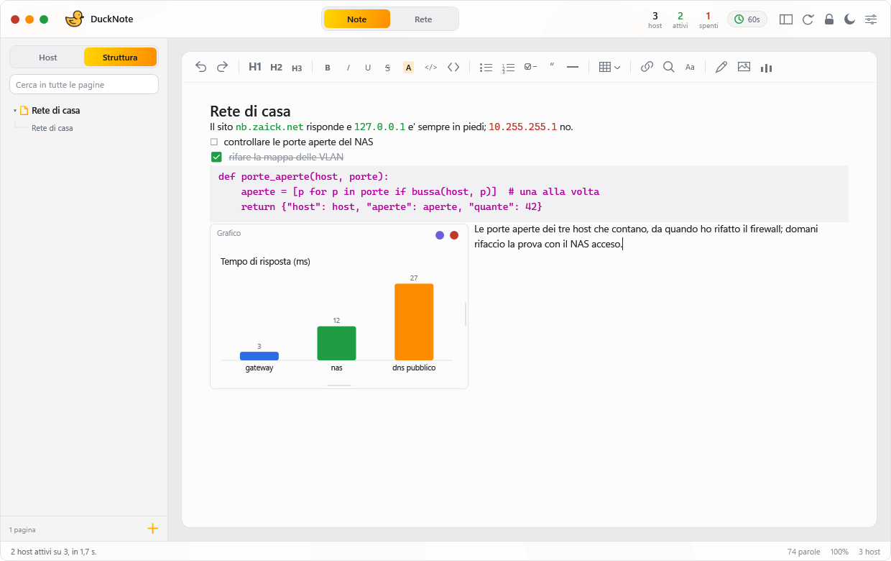
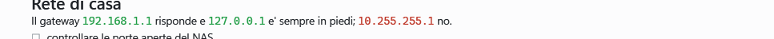
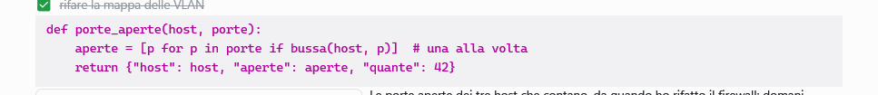
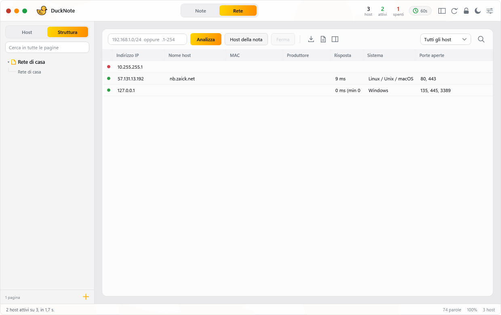

<div align="center">


**Technical notes and a network scanner in the same window.**
Write an address in the note and DuckNote checks it; scan a subnet and the
results come back into the note. One executable, nothing to install.

[](https://github.com/Zaick99/DuckNote/releases/latest)
[](https://github.com/Zaick99/DuckNote/releases)
[](https://github.com/Zaick99/DuckNote/stargazers)
[](https://github.com/Zaick99/DuckNote/commits)


[](LICENSE)

[**Download**](https://github.com/Zaick99/DuckNote/releases/latest) ·
[What it does](#what-it-does) ·
[How to use it](#how-to-use-it) ·
[Encryption](#encryption) ·
[Changelog](CHANGELOG.md)

<picture>
  <source media="(prefers-color-scheme: dark)" srcset="docs/images/ducknote-dark.png">
  
</picture>

</div>

> The application's interface is in Italian. Every label is quoted here exactly
> as it appears on screen, with its meaning in English.

---

## In one picture

**Addresses live in the text.** Write `nb.zaick.net` or `10.0.0.7` in a note and
it is checked on its own a moment after you stop typing — green reachable, red
down, grey never checked — and the colour updates as results arrive, without the
text moving.

<picture>
  <source media="(prefers-color-scheme: dark)" srcset="docs/images/ducknote-host-dark.png">
  
</picture>

**A code block is coloured by the language it speaks** — guessed from the code
itself, because there are no fences to write. Keywords, strings, numbers,
comments and the names of functions, each in its own colour.

<picture>
  <source media="(prefers-color-scheme: dark)" srcset="docs/images/ducknote-codice-dark.png">
  
</picture>

**And the same window is a scanner.** Everything the scan collected — hostname,
MAC and vendor, response time, the operating system it looks like, open ports —
in one table, with the rows written by your notes alongside the ones you scanned
by range.

<picture>
  <source media="(prefers-color-scheme: dark)" srcset="docs/images/ducknote-rete-dark.png">
  
</picture>

---

## Download

| File | What it is |
|---|---|
| [`DuckNote.exe`](https://github.com/Zaick99/DuckNote/releases/latest) | portable, 62 MB — the .NET runtime, WPF and the application in one file. Nothing to install. |
| [`DuckNote-setup.exe`](https://github.com/Zaick99/DuckNote/releases/latest) | installer, 58 MB — installs for the current user, no elevation, with shortcuts and an uninstall entry. |

Windows 10 or 11, 64-bit. Neither binary is signed, so SmartScreen warns on the
first run — the SHA-256 of both files is in every release.

---

## The change of direction

**DuckNote used to be a single PowerShell script — 10,143 lines of it. Since
0.0.4 it is a C# application on .NET 10.**

The script had reached the point where every new feature cost more than it was
worth. WPF built by hand from XAML strings, two different scan engines to
support both PowerShell 5.1 and 7, Argon2id implemented in a language without
unsigned 64-bit arithmetic, and no way to test any of it without launching the
whole window.

What the rewrite bought:

| | PowerShell | C# / .NET 10 |
|---|---|---|
| Scan engine | two, one per PowerShell version | one, `Channel` + `IAsyncEnumerable` |
| Tests | none that could run headless | 132, run in about a second |
| Startup | script extraction, BOM dance, hash check | a single executable |
| Argon2id | hand-rolled 64-bit arithmetic | same algorithm, verified against RFC 9106 §5.3 |
| Type errors | at runtime, in front of the user | at compile time |

**Containers written by the PowerShell version still open.** A set of fixtures
generated by the original script is committed to the repository, and a test
suite opens them with the new code on every build. The file format did not
change.

The original script is not in this repository: it belongs to the history that
ended here. What survives of it are the fixtures under `tests/`, generated by
it, which keep the new code honest about the file format.

### What is not ported yet

The rewrite is not finished. These exist in the interface — the XAML is the
original one — but have no code behind them yet:

- table filter and search, and the status dropdown
- CSV export, and sending scan results into the note as a table
- zoom
- highlighting every match of a search, not only the current one

Everything else in this page is implemented and works. The missing pieces are
wired into the interface and waiting for their code.

---

## What it does

**You type text and press a button — there is no markup to remember.** Headings,
bold, italic, underline, strikethrough, highlight, inline code, code blocks,
lists, numbered lists, quotes, checkboxes, links, separators. A separator is a
line, not three dashes. A code block is one block, not a fence above and a fence
below. A bullet is a bullet, not a hyphen. Asterisks, backticks and `#` are
characters like any other: `2 * 3 * 4` stays as written.

Markdown used to be the way in, and it was the wrong one — a parser watching
every keystroke, deciding when a marker had closed, and rewriting the line under
the caret. Notes written that way are read exactly as before; nothing is lost.

**Every button works on the selection.** Select three lines, press any button,
and all three change: a style sits on the text, so there is no syntax that has
to open and close inside one line. Underline and strikethrough can coexist. A
line's look replaces the one it had, the numbered list counts, and the code
block takes exactly what you selected.

**A code block is coloured by the language it speaks.** The words the language
keeps for itself, text between quotes, numbers, comments and the names of
functions, each in its own colour. Nothing says which language it is — there are
no fences — so it is guessed from the signs a language leaves lying around: C#,
Python, JavaScript, Rust, PowerShell, SQL and shell. When the signs are not
enough the block stays as it was, because colouring at random is worse than not
colouring. Inside a block an address is code, not a host.

**A separator takes one line.** It goes on the line right under the one you are
writing, what was below stays where it was, and you carry on on a line of its
own beneath it.

**Enter knows where it is.** Inside a code block it adds a line to the block,
and on an empty line at the end of the block it closes it and leaves you on a
normal line below — Shift+Enter adds a line without leaving. On a list item it
starts the next one; on an empty item it ends the list; after a heading it goes
back to writing normally.

**Links keep their address.** The link button opens a small window in the same
dress as the rest: the selected text on one side, the address on the other,
and a way to take the link off that leaves the text behind. A link is a real
hyperlink, so the address survives the note being closed and reopened, and
Ctrl+click opens it. Anything that is not http, https or mailto is refused.

**Find works like Ctrl+F elsewhere.** A small panel slides down over the top
right of the note: type and it jumps to the first match and counts them, Enter
and the arrows walk them, F3 and Shift+F3 too, Esc closes. Matches are found
across runs, so a word half in bold is still one word. Replace sits behind a
toggle so the panel stays small.

**Right-click knows what it is looking at.** On an address in the note:
analyse it now — which adds it to the host table — set it aside so it is never
scanned again, or copy it. On anything else those entries do not appear. A host
set aside stays out of single scans, ranges and the monitor, and is remembered
between runs; the host list's menu lists the ones set aside, one click to take
them back.

**Real tables.** The table buttons build a grid, not rows of pipe characters:
a header with its own background, one-pixel borders, cells you tab through. They
live under the **Tabella** menu in the bar: inserting one, and adding or
removing rows and columns around the caret. Tables written as rows
of pipe characters, back when they could only be text, are recovered — put the
caret in such a block, choose *Inserisci tabella*, and it becomes a real table.

**Drawings, images and charts live in the text.** The last three buttons in the
bar drop a framed box where the caret is: a sheet you draw on with the mouse,
an image from a file, or a chart built from a few numbers you type. A frame is
as wide as it needs to be and **text wraps around it**, line after line and
Enter included, returning to full width once the frame ends; put a second one
next to the first and they split the line evenly, tops aligned. Drag the bottom
edge for height and the right edge for width — the width stops at the page. Pasting a screenshot with Ctrl+V inserts it as
an image instead of leaving behind something that would vanish on reopening.

A chart stays editable: it keeps the lines you wrote (`gateway 3`, one per line,
with `tipo:` for bars, lines or a pie and `titolo:` for its name), so you change
a number rather than redrawing a picture. Bars, line and pie take their colours
from the theme. A drawing keeps its own paper and ink — a sketch made at night
is still legible by day. Every frame is stored beside the page inside the note
container: ink as strokes, an image as its original bytes, a chart as its text.

**Network scanner.** Ping, TTL and operating-system guess, reverse DNS,
NetBIOS, mDNS, SSDP/UPnP, SNMP v2c, MAC and vendor (IEEE OUI database), open
ports with service recognition, HTTP/SSH/FTP/SMTP banners, TLS certificate,
SMB shares.

**The two talk to each other.** Addresses written in the note become the list
of hosts to check, and a new one is **checked on its own a moment after you
stop typing** — not at the next sweep of the monitor, which can be a minute
away. The wait is deliberate: on the way to `nb.zaick.net` you pass through
`nb.zaick.ne`, as valid a name as its continuation and not worth looking up.
The address under the caret is still a word being written: it becomes a host
when the caret leaves it — a space, Enter, a click elsewhere — or five seconds
after the last key. Delete it and its row goes with it; rows from a scan by
range stay, because no note was claiming them. The results colour the addresses
back in the note without the text moving.

**Host card.** Clicking a host — in the table or in the sidebar — opens a card
docked to the side of the window with everything the scan collected, in
sections. It follows the window when it moves and switches side when it runs
out of room. Clicking the same host again closes it.

**Ducks.** They swim behind the editor, bump into each other and bounce off the
edges, at whatever opacity you set in the settings — 4% by default, which is
about as loud as a watermark. They stop while you type.

**Locked, if you want it.** A password turns the note, its backup, the last
scan and the excluded hosts into one encrypted container: Argon2id over 256 MiB
for the key, AES-256 for the content, padding so the file size says nothing.
The key leaves memory after 15 idle minutes and the note asks for the password
again. It is offered at the first start, and the padlock in the toolbar turns
it on at any time later.

## Requirements

| | |
|---|---|
| System | Windows 10 / 11, 64-bit |
| Anything else | nothing: the runtime is inside the executable |

---

## Starting it

Download `DuckNote.exe` from the release and double-click it, or run the
installer. The executable is self-contained: no .NET installation required.

It is not signed, so SmartScreen warns on the first run. The SHA-256 of every
release binary is published with the release.

---

## How to use it

### Note view — **Note**

You write, select, and press a button in the bar; the keyboard shortcuts work
too. Addresses go wherever they land: **IPv4, IPv6 and domain names are
collected from the whole text**, mid-sentence included, as many per line as you
like.

```
The gateway is 192.168.1.1, and behind it the NAS nas.home.lan that keeps vanishing.
DNS: 1.1.1.1 and 1.0.0.1, plus 2606:4700:4700::1111 for IPv6.
- [ ] check 10.0.0.50 before Friday
```

Every recognised address is set in monospace and **coloured by its state**:
green reachable, red down, grey never checked. The colour updates on its own as
scan results arrive, without the text moving.

Whatever is not an address stays out: `notes.md`, `schema.sql`,
`C:\path\file.xaml`, `version 1.2` and `name@example.com` do not become hosts.
The rule: known file extensions are excluded, and a real domain has its suffix
either all lowercase or all uppercase.

### Network view — **Rete**

| Command | What it does |
|---|---|
| `192.168.1.0/24` + **Analizza** | scan a range (CIDR, `from-to`, `.1-254`, comma-separated lists) |
| **Host della nota** | scan only the addresses written in the note |
| **Ferma** | stop the running scan |
| **Dettagli** | open the host card docked alongside |

The sidebar switches between **Host** and **Struttura**, with a filter box over
each. Picking a heading scrolls the note to its line — it travels there rather
than jumping, so you can see where you came from.

**Struttura is a tree of pages.** Under each page are its `#` headings, and
under each of those the `##` headings that follow it — an `##` with no `#` above
it hangs straight off the page. `###` is detail inside a section and would only
be noise in the structure, so it is left out.

Tree lines show what leads where: a vertical for every branch that continues
below, an elbow into each entry. Folding is animated both ways, and what you
fold stays folded while you keep typing.

A page reads as a section title with a filled toggle; a section is smaller and
tighter, with a thin chevron — opening a page and opening a section are not the
same act and do not look like it. The open page carries an accent dot, and a
count appears only when a search found the word inside a page's body.

**Pressing a page takes you back to the top of it**, onto its title, even when
it was already the open one. Pressing a section takes you to its line.

**A page is named by hand, and only by hand.** The `+` button makes one;
right-click → *Modifica titolo* writes the name in a field on its own row, no
dialog. Inside that field the text behaves like text — clicking it places the
caret, double-clicking selects it all — and the name is saved when you click
anywhere else. A page with no name reads *Senza titolo*: nothing in the text renames
it, because a page that renames itself as you write is a page you cannot keep
track of. Right-click also removes a page, except the last.

**The filter searches every page** — names, headings, and the text inside: a
page whose body contains the word stays in the list and says how many times.

---

## Shortcuts

| Keys | Action |
|---|---|
| `Ctrl+L` | lock now |
| `Ctrl+wheel` | grow the text |

The other shortcuts of the PowerShell version are not wired yet.

---

## Encryption

Offered at the first start — **Piu' tardi** declines — and available any time
afterwards from the padlock in the toolbar, which shows an open shackle while
the note has no key. While encryption is on, every start goes through the
unlock screen.

**How the key is made.** The password never becomes the key: **Argon2id**
(256 MiB, 3 passes, 4 lanes) then **PBKDF2-HMAC-SHA512** (600,000 iterations)
produce a key-encryption key, which only unwraps the random 256-bit key the
data is actually encrypted with — so changing the password rewrites a hundred
bytes, not the note. Content is **AES-256-CBC with HMAC-SHA256**,
encrypt-then-MAC, with a fresh IV per write and the MAC verified before any
decryption.

**Why those parameters.** There is no key exchange here and no signature, so
there is nothing for a quantum computer's Shor algorithm to attack: the
container is symmetric end to end. Grover takes AES-256 down to about 128 bits
of effective security, which is out of reach. Your password is the real attack
surface, so the cost is spent there — 256 MiB per guess makes GPUs and ASICs,
the hardware that actually breaks passwords, wildly inefficient. Against a
hundred datacentre GPUs, four random diceware words hold for centuries, three
for weeks, and `Estate2026!` for minutes. The strength bar measures length
times alphabet, not unpredictability: use dice, not inspiration.

**What it covers.** Note, previous note, last scan, excluded hosts and last
range, all inside `store.bin`. Content is padded to 4 KiB steps so the file
size says nothing about what you wrote, and file timestamps are pinned.
`settings.json` stays readable because the window is built from it before any
key exists. **While a container exists, nothing is ever written in the clear**,
and cleartext leftovers found beside it are overwritten and removed at unlock.

**Locking.** The padlock — or `Ctrl+L` — locks on the spot, and after 15 idle
minutes (configurable, 0 disables) it happens by itself: the note is saved,
**the key leaves memory**, and the window is covered by the lock screen, which
asks for the password right there rather than in a separate window. While
running, the key sits outside the managed heap in a page pinned with
`VirtualLock`, so it never reaches `pagefile.sys`, and encrypted with
`CryptProtectMemory` whenever unused. Passwords read from the input boxes are
disposed rather than left for the garbage collector.

**A wrong password is shown, not written.** The screen shakes, the field and
its label flash red, the rings around the duck change colour and speed up, and
what was typed erases itself — no dialog to dismiss.

**What it does not cover.** Malware or a keylogger in your account, a debugger
on a running unlocked instance, a replaced executable, your screen being
watched, and any cleartext copy made *before* you turned encryption on — shadow
copies, File History, a sync folder. On an SSD, overwriting in place is only a
partial defence.

**If you lose the password, the note is gone.** There is no recovery key and no
back door — that is the point.

---

## Where the data lives

All of it in `%APPDATA%\DuckNote`, or in the folder named by `DUCKNOTE_HOME` if
that variable is set — useful for keeping the note and the container on a USB
stick next to the executable.

| File | Contents |
|---|---|
| `note.xaml` | the note, when encryption is off: a zip with one entry per page and an index holding their order and their names — despite the name, which earlier versions gave it when the note was one document |
| `note.xaml.bak` | the previous version, refreshed at most every 15 minutes |
| `settings.json` | the settings |
| `lastscan.json` | the last scan, so states are found again on reopening |
| `store.bin` | with encryption on: **everything** — parameters, salt, wrapped key, note, previous note, last scan, excluded hosts, last range |
| `store.bin.bak` | a copy of the container, refreshed at most every 15 minutes |

Nothing leaves the computer: the only connections are the ones towards the
hosts you ask to scan.

---

## Building

```powershell
dotnet build DuckNote.sln
dotnet test DuckNote.sln
```

The portable executable:

```powershell
dotnet publish src/DuckNote.App -c Release -r win-x64 --self-contained true `
  -p:PublishSingleFile=true -p:IncludeNativeLibrariesForSelfExtract=true `
  -p:EnableCompressionInSingleFile=true -p:DebugType=none -o dist
```

Everything ends up in one `DuckNote.exe` of about 62 MB: the .NET runtime, WPF
and the application. No dependencies to install on the target machine.

---

## Project layout

```
src/DuckNote.Core    cryptography and the encrypted container, no UI
src/DuckNote.Scan    the scan engine and the wire protocols, no UI
src/DuckNote.App     the WPF application
tests/               132 tests, including compatibility with PowerShell fixtures
packaging/           the Inno Setup script that builds the installer
_old/                the PowerShell original: 10,143 lines, its launcher and
                     its build script — the only copy of what came before
dist/                build output, not in the repository: the portable
                     executable, the installer, and the notes that ship with it
```

`DuckNote.Core` and `DuckNote.Scan` have no reference to WPF: they run headless,
which is what makes the tests possible.

One folder holds everything — source, history and the build you hand to
someone. `dist/` is written by `dotnet publish` and regenerates from scratch, so
it is not versioned; there is never a second copy of a release somewhere else to
open by mistake.

---

## A note on use

Network scanning belongs **on your own networks, or where you are authorised**:
SNMP probes and share enumeration are intrusive activities, and on someone
else's network they can be unlawful.

---

## Stars over time

<div align="center">

<a href="https://star-history.com/#Zaick99/DuckNote&Date">
  <picture>
    <source media="(prefers-color-scheme: dark)" srcset="https://api.star-history.com/svg?repos=Zaick99/DuckNote&type=Date&theme=dark">
    
  </picture>
</a>

</div>

The chart is drawn when the page is opened, so it is never out of date.

---

## License

MIT — see [LICENSE](LICENSE). Use it, change it, ship it; keep the copyright notice.
