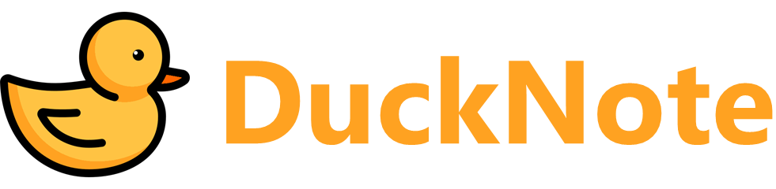
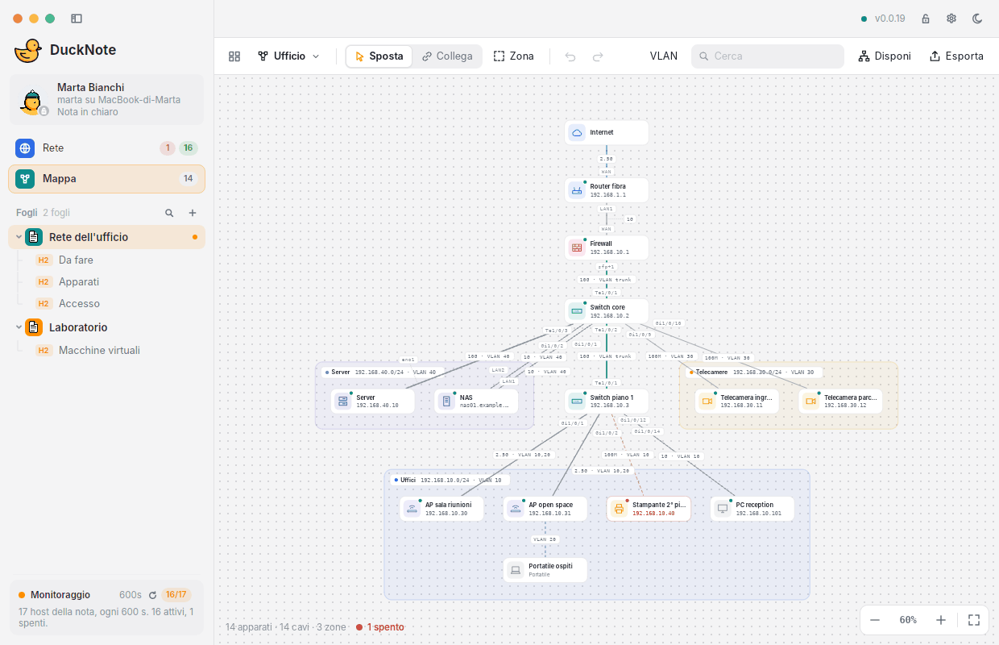
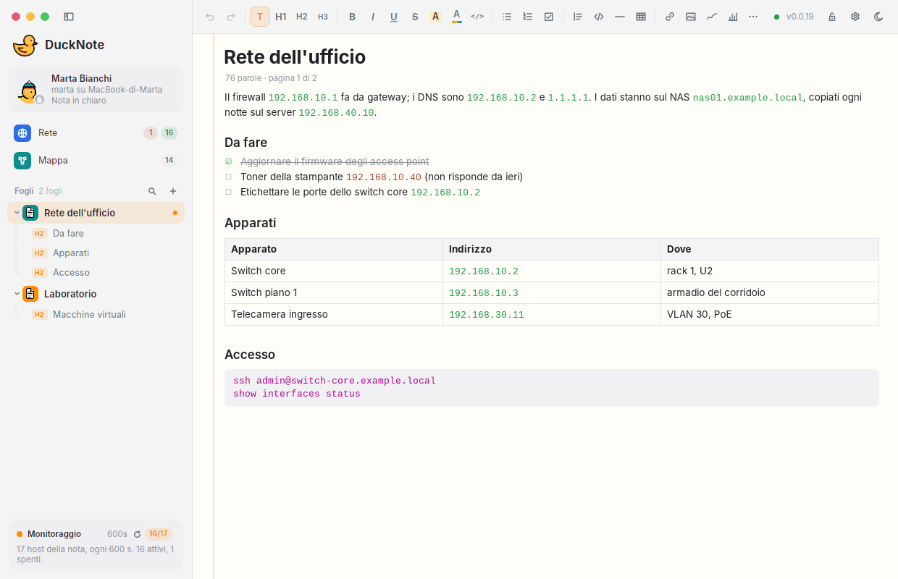
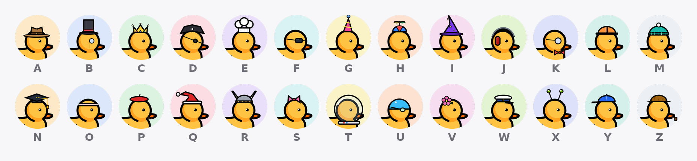
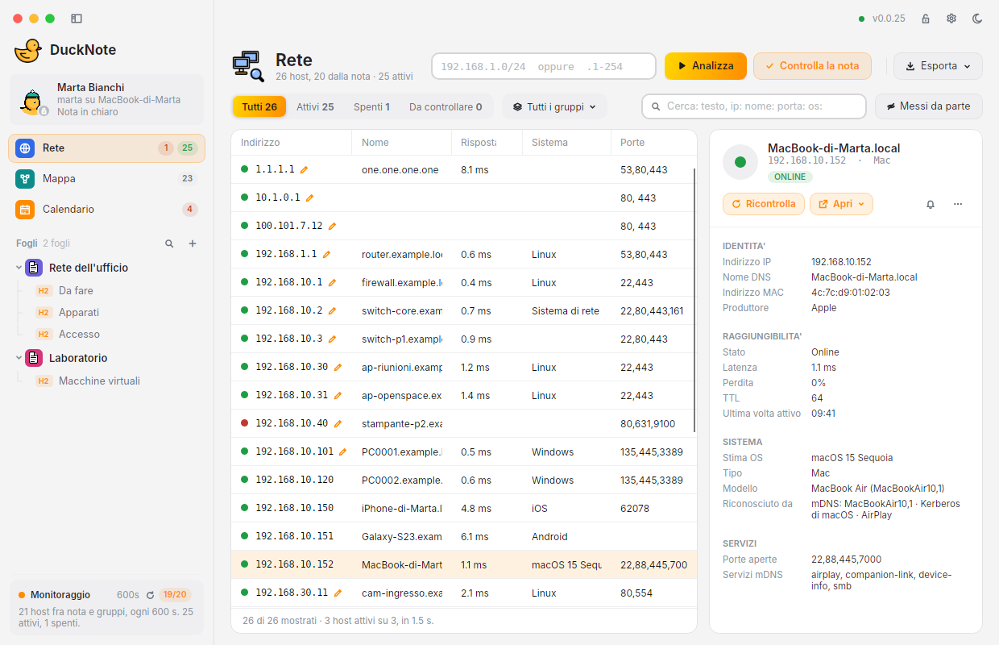
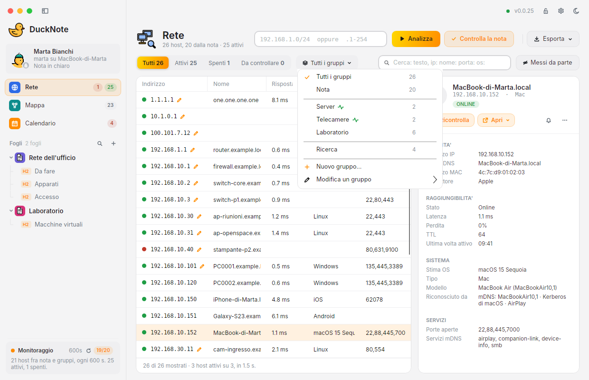
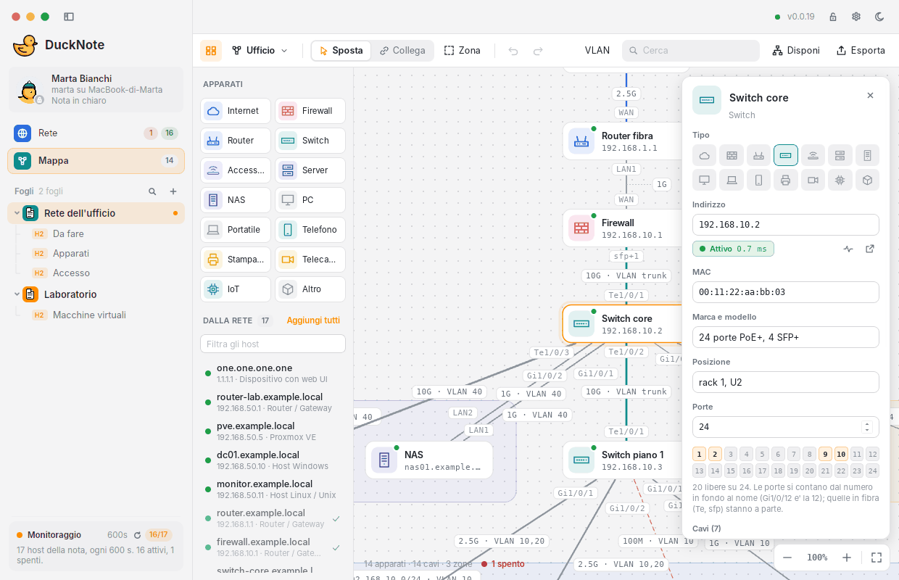
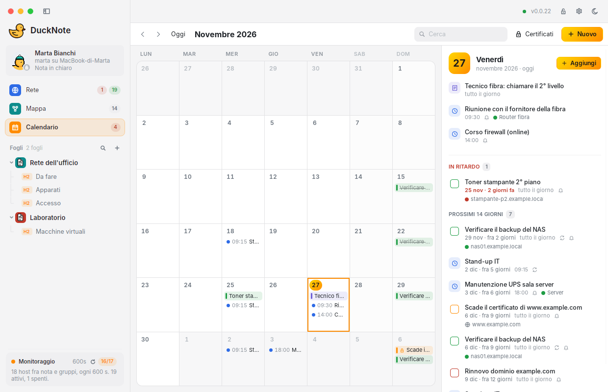

<div align="center">



**Technical notes, a network scanner, a network map and a calendar in the same window.**
Write an address in a sheet and DuckNote checks it; scan a subnet and the results
come back into the note; draw the network and every device shows its state;
keep the deadlines — certificate expiry dates arrive by themselves.
For Windows and macOS. One file, nothing to install.

[](https://github.com/Zaick99/DuckNote/releases/latest)
[](https://github.com/Zaick99/DuckNote/releases)


[](LICENSE)

[**Download**](https://github.com/Zaick99/DuckNote/releases/latest) ·
[The window](#the-window) ·
[Writing](#writing) ·
[Network](#network--rete) ·
[Map](#map--mappa) ·
[Calendar](#calendar--calendario) ·
[Encryption](#encryption) ·
[Building](#building) ·
[Changelog](CHANGELOG.md)

<br>

<picture>
  <source media="(prefers-color-scheme: dark)" srcset="assets/readme/map-dark.png">
  
</picture>

</div>

> The interface is in Italian. Labels are quoted here exactly as they appear on
> screen, with their meaning in English. The pictures are real screenshots, taken
> on a demo note: private addresses and `example.local` names.

---

## Download

| File | What it is |
|---|---|
| `DuckNote.exe` | Windows, portable, about 74 MB — the .NET runtime, WPF and the application in one file. Nothing to install. |
| `DuckNote-<version>-setup.exe` | Windows installer — installs for the current user, no elevation, with shortcuts and an uninstall entry. |
| `DuckNote-<version>-macos-arm64.dmg` | macOS, Apple Silicon — drag DuckNote to Applications. |
| `DuckNote-<version>-macos-x64.dmg` | macOS, Intel. |

Windows 10 (version 1809 or later) or 11, 64-bit; macOS 14 or later (15 or
later recommended, as for .NET 10). On Windows the map uses Microsoft Edge
WebView2, already part of Windows 10 and 11; where it is missing or cannot
start, the map page says what went wrong and the rest of DuckNote works
without it.

No binary is signed with a certificate yet: SmartScreen warns on the first run
on Windows, and on the Mac the app (ad-hoc signed) is opened the first time from
**System Settings › Privacy & Security › Open Anyway**. Only the first
installation needs it: the versions DuckNote downloads and installs itself open
directly. The SHA-256 of every file is published with each release, and the
running executable shows its own in **Impostazioni › Sistema** (Settings ›
System).

**DuckNote updates itself.** A few seconds after startup it asks GitHub for
the latest release; if it is newer, it downloads the file for this installation
(portable exe, installer or the disk image for this Mac), keeps it only if its
SHA-256 matches `SHA256SUMS.txt` of the same release, and installs it when
DuckNote closes — or at once, with **Riavvia e aggiorna** (restart and update).
It checks again every six hours, so a DuckNote left open for days updates too.
If the new version cannot replace the old one by itself, DuckNote says why and
opens what it downloaded (**Apri l'aggiornamento**): on the Mac the disk image —
drag DuckNote to Applications — on Windows the installer, or the new
`DuckNote.exe` in Explorer. A copy opened from the disk image or kept in a
read-only folder shows the release page instead. Automatic updates start from
0.0.18; on the Mac they are reliable from 0.0.20.

The Mac version is the same application rebuilt on Avalonia, with the sheet
and the map in the native web view: same pages, same files, same vault. On
first use macOS 15 asks whether DuckNote may reach the local network — the
scanner needs it.

---

## The window

A macOS-style window on the **Duck** design kit: traffic lights, a sidebar,
one orange accent, day and night themes that crossfade and can follow the
system, illustrations in the style of the duck.

<div align="center">

<picture>
  <source media="(prefers-color-scheme: dark)" srcset="assets/readme/sheet-dark.png">
  
</picture>

*A sheet. Each address is coloured by its state: green up, red down.*

</div>

| Where | What is there |
|---|---|
| top left | the traffic lights and the button that **hides the sidebar** (`F9`) |
| top, middle | while a sheet is open, the **formatting bar**: it lives in the title strip, so the sheet gets the whole height |
| top right | a dot that tells whether the note is saved (orange: changes waiting, green: on disk), the version, the **padlock** (lock now, or set up encryption), the **Impostazioni** gear (pressed again, it goes back to where you were), day/night |
| sidebar, top | **DuckNote**, then the user: the account's full name, `user su computer`, a picture chosen among 26 dressed-up ducks by the first letter of the name, and the state of the vault. A click opens a menu: lock the note or quit — without encryption, it offers to set it up |
| sidebar | **Rete** (Network), with the number of hosts down (red) and up (green); **Mappa** (Map), with the number of devices drawn; **Calendario** (Calendar), with the items of today and those late (red) |
| sidebar, middle | **Fogli** (Sheets): the sheets, each on a tile of its own colour, with their H1/H2 titles always at hand; 🔍 searches them, + adds one |
| sidebar, bottom | the monitoring card, with the button that checks the hosts of the note |
| the rest | the open sheet, or the **Rete**, **Mappa**, **Calendario** or **Impostazioni** page |

**All the room to the sheet.** `F9` (or `Ctrl+\`, or the button next to the
traffic lights) slides the sidebar away and the page takes the whole window;
the same key brings it back. While it is hidden, resting the mouse on the left
edge makes it **peek** over the page for as long as you use it, and
`Ctrl+Shift+F` brings it up with the cursor in the search.

**Movement says what happened.** Buttons press in and spring back, the
segmented controls slide their pill to the chosen item, pages and cards fade
in: the same curves on Windows and on the Mac, written out by hand where the
platform has none of its own.

While locked, the whole window is one colour and asks for the password in
place; only the version and day/night stay on top.

<div align="center">



*The user's picture: one duck per initial, A to Z.*

</div>

---

## Writing

**A sheet is a page of paper**, and the page is all there is: no bar above it,
no strip below. Its title is written at the top and renames it; under the title
the words, the page number, the time of the last save, the zoom and whether the
note is encrypted. Title and margins **scroll away with the text**, so two
turns of the wheel leave the whole height to what you are writing.

**The bar formats, the keyboard too.** Every command of the formatting bar is a
row in one table, with its icon, name, shortcut and state:

- toggles (bold, titles, lists, quote, code...) **stay pressed** where the
  cursor is;
- what cannot be used is **greyed out**, not hidden;
- every tooltip gives the **name and the shortcut**;
- the bar never wraps: what does not fit goes into the **⋯** menu;
- with nothing selected, a mark applies to the **word under the cursor**, or to
  what you type next;
- **Alt+F10** reaches the bar from the keyboard, the arrows move along it, Esc
  returns to the text.

**Enter starts a clean line** — no title, list, quote, code, bold or colour.
**Shift+Enter** keeps the formatting: the next list item, the next line of the
code block, the same title.

**Markdown-style starts**: `#`, `##`, `###`, `-`, `1.`, `[]`, `>` or ` ``` `
followed by a space at the start of a line turn it into a title, list,
checklist, quote or code block.

**Also in the note**: text colours from the theme, highlight, inline code,
links (http, https, mailto; Ctrl+click opens them), real tables, separators,
code blocks coloured by the language they look like (C#, Python, JavaScript,
Rust, PowerShell, SQL, shell), find and replace, and framed **drawings, images
and charts** the text wraps around. Right-click on a table, a separator, a code
block or a quote deletes it (Ctrl+Z brings it back).

**Addresses live in the text.** IPv4, IPv6 and domain names are collected from
the whole note, mid-sentence included, set in monospace and **coloured by
state** — green reachable, red down, grey never checked — a moment after you
stop typing, without the text moving. File names, versions and e-mail
addresses are left alone; so is what is written in code blocks. Right-click on
an address: analyse it now, show its card, stop analysing it (and put it back
later), copy it.

---

## Network — Rete

<div align="center">

<picture>
  <source media="(prefers-color-scheme: dark)" srcset="assets/readme/network-dark.png">
  
</picture>

*The hosts of the note and of the map, and the card of the selected one.*

</div>

| Command | What it does |
|---|---|
| `192.168.1.0/24` + **Analizza** | scan a range (CIDR, `from-to`, `.1-254`, comma-separated lists) |
| **Host della nota** | keep in the list only the hosts of the note (sheets and map), and check them |
| **Tutti · Attivi · Spenti · Da controllare** | all, up, down, to check |
| **Tutti i gruppi** ▾ | which hosts to show: all, those of the note (**Nota**), those of a scan group, or those found by a range scan outside every group (**Ricerca**); groups are created and edited from the same menu |
| **Analizza «gruppo»** | with a group chosen, the second button scans all of it: its networks, ranges and addresses |
| search box | free text, or by field: `ip:` `nome:` `mac:` `porta:` `os:` `tipo:` `produttore:` `gruppo:` `web:` `nota:` `stato:` |
| export / to the note | what is shown, to CSV (opens in Excel as is) or into the sheet as a table |
| **Messi da parte** | hosts set aside, one click (or a right-click on the table) to take them back |

Every row starts with a dot — **green online, orange to check, red offline** —
then the IP and the name. Selecting a row fills the card on the right with
everything the scan collected: names, MAC and vendor, response time, the
operating system it looks like, the kind of device, open ports and services,
HTTP/SSH/FTP/SMTP banners, TLS certificate, SNMP, UPnP, SMB shares, WMI
inventory.

**The full analysis runs once per start.** After that, the monitor and every
new check only **ping**: names, MAC, ports and the rest stay as they were found.
A host that comes back on is analysed in full again. Automatic checks never
pop up a notification; the ones you start do.

### Scan groups

**Name the parts of the network you scan, and scan them by name.** The note
has a group of its own, **Nota** — the addresses written in the sheets and on
the map. Next to it, any number of groups: **Server**, **Telecamere**,
**Laboratorio**, each with its networks (`192.168.40.0/24`), ranges
(`192.168.50.10-50`), single addresses and names, one per line. The editor
says how many addresses a group covers and points at the first line written
wrong.

<div align="center">

<picture>
  <source media="(prefers-color-scheme: dark)" srcset="assets/readme/groups-dark.png">
  
</picture>

*The group menu: every group with its hosts; the pulse marks the monitored ones.*

</div>

- **Monitora**, group by group: on, the hosts of the group are checked by the
  monitor like those of the note — single addresses at once, the hosts of its
  networks after their first scan; off, the group is scanned only when you
  press **Analizza**.
- a scan of a range no longer drops the hosts of the groups, and a host found
  by a range scan shows up in its group by itself;
- the hosts of a monitored group do not get the pencil of the note: the pencil
  stays for what is written in the sheets;
- groups are saved inside the note, encrypted with it when the vault is on.

---

## Map — Mappa

**Draw the network, and every device shows its state.** **Mappa** is a canvas
for the network as it is cabled: devices, cables with their ports and VLANs,
zones for the subnets. It is drawn by hand, or started from what the scan
already found, and it is saved inside the note — encrypted with it when the
vault is on. A note can hold several maps (an office, a home, a lab): the menu
with the map's name switches between them, and creates, renames, duplicates
and deletes them.

<div align="center">

<picture>
  <source media="(prefers-color-scheme: dark)" srcset="assets/readme/map-switch-dark.png">
  
</picture>

*A switch and its card: state, model, place, and the front panel of its ports.*

</div>

| Where | What is there |
|---|---|
| top bar | the map menu; **Sposta · Collega** (move, connect); **Zona**; undo and redo; the **VLAN** filter; the search; **Disponi** (lay out); **Esporta** (export) |
| left, **Apparati** | 14 kinds of device — Internet, firewall, router, switch, access point, server, NAS, PC, laptop, phone, printer, camera, IoT, other. Drag one onto the map, or click it to drop it in the middle |
| left, **Dalla rete** | the hosts DuckNote knows — written in the sheets or found by a scan — with their state, group by group: **Tutti i gruppi**, **Nota**, a scan group, **Ricerca**. Dragged onto the map, a host arrives with its name, address, MAC, vendor and the kind of device the scan recognised. **Aggiungi tutti** brings in those of the chosen group still missing, each into the zone of its subnet |
| right | the card of what is selected: a device, a cable, a zone, or several of them |
| bottom | how many devices, cables and zones, how many devices are down; the zoom |

**Every device with an address is checked like an address in a sheet.** Green
up, red down, grey never checked; a cable to a device that is down turns red
and dashed. The monitor pings the devices of the map together with the hosts of
the sheets, and they count in the badges of **Rete**. From a device's card,
one click checks it now, another opens it in **Rete**, and **Promemoria** starts
an item of the calendar tied to the device.

**Cables carry what it takes to rebuild the network.** The type — copper,
fibre, Wi-Fi, VPN, WAN, each drawn its own way — the speed, from 10M to 100G
(faster cables are drawn thicker), the port at each end (`Gi1/0/12`, `eth0`)
and the VLANs (`10`, `10,20,30-35`, `trunk`). Two cables between the same two
devices run side by side, as an aggregate or a spare link does.

**Labels never cover each other.** Ports sit near the ends of their cable,
speed and VLAN in the middle. Each label takes the first free place along its
cable, then beside it, keeping clear of devices, zone titles and other labels;
when it has to stand aside, a dotted thread ties it to its cable. Short cables
keep their labels too.

**Switches show their front panel.** Give a switch, router or firewall its
number of ports and the card draws them: a port is taken when a cable names it
(the number at the end of the name: `Gi1/0/12` is port 12), a click on it
selects that cable, and the card says how many are free. Fibre uplinks (`Te`,
`sfp`) are counted apart.

**Zones are subnets.** A coloured area with a name, a network
(`192.168.10.0/24`, with its number of usable addresses) and a VLAN. Moving a
zone moves what is inside it; **Z** draws one around the selected devices.
Hosts of the scan that belong to the zone's network and are not on the map yet
are one click away from its card.

**Find what you are looking for.** The search lights up the devices that match
by name, address, MAC, model, place or note, and Enter jumps from one to the
next. The **VLAN** filter keeps lit only the cables, zones and devices that
carry the chosen VLAN.

**Disponi lays the network out from the top.** Internet, then firewall,
router, switches, then what depends on them, each centred above its own; the
many end devices of a switch go into a grid under it, unconnected devices at
the bottom, and zones follow their devices. With devices selected, only those
are arranged. One `Ctrl+Z` undoes it.

**Editing feels like a drawing program.**

- drag to move: positions snap to an 8-pixel grid and to the centres of other
  devices, with a guide line; `Alt` moves freely;
- `Shift`+drag selects with a rectangle; a drag on the empty canvas pans; the
  wheel or a pinch zooms;
- a cable is pulled from the dot on the edge of a device (in **Collega**, from
  anywhere on it); dropped on the empty canvas it offers a new device, already
  connected;
- a double click on the canvas adds a device right there; on a device, it
  renames it;
- copy, cut, paste and duplicate work on devices together with their cables;
  pasting a list of addresses creates one device per address;
- align and distribute several devices from their card;
- undo and redo for everything, map by map.

**Export** to PNG (twice the screen resolution), to SVG (plain colours: it
opens in any drawing program) and to two CSV files, the device inventory and
the cable list, that Excel opens as they are.

**Not done**: the map is drawn, not discovered. DuckNote does not read LLDP,
CDP or the MAC tables of switches; what is connected to what is up to you.

---

## Calendar — Calendario

**The day of the network: appointments, things to do, deadlines.** The
certificate of the website expires on 14 April, the UPS needs a technician on
Thursday, the backup of the NAS is checked every Monday. **Calendario** keeps
them in the note, next to the sheets and the map, and reminds you while
DuckNote is open.

<div align="center">

<picture>
  <source media="(prefers-color-scheme: dark)" srcset="assets/readme/calendar-dark.png">
  
</picture>

*The month, and on the right the day, what is late and what is coming.*

</div>

| Where | What is there |
|---|---|
| top bar | previous and next month, **Oggi** (today), the search, **Certificati** (certificates), **Nuovo** (new) |
| the month | six weeks from Monday; each day with its items, timed ones with their hour, and `+N` for the rest. A click chooses the day, a double click adds an item to it, an item that does not repeat is dragged to another day |
| right | the chosen day; **In ritardo** (late: things to do and deadlines not done, up to 30 days back); the next 14 days. A tick marks a thing to do as done |

**Four kinds of item**: **Appuntamento** (an appointment, with its hour),
**Da fare** (a thing to do), **Scadenza** (a deadline) and **Appunto** (a note
for the day). Each can:

- **repeat** every day, week, two weeks, month, three or six months, year —
  until a date if you want; the 31st falls on the last day of shorter months
  and comes back to the 31st after them. Deleting asks whether to remove only
  that time or all of them;
- **remind** at the moment, minutes, hours, days or weeks before; items of the
  whole day remind at 9:00;
- **link to a host or to a device of the map**: the item shows its state (green
  up, red down), and a click opens it in **Rete** or on the map. **Aggiungi un
  promemoria** in the right-click menu of **Rete**, and **Promemoria** in the
  card of a device, start an item already linked.

**Reminders while DuckNote is open.** When one comes due, a card stays in the
corner until you answer it: **Fatto** (done), **Rimanda** (in 10 minutes, in an
hour, tomorrow at 9) or **Apri** (open it in the calendar). If DuckNote is
behind other windows, its icon bounces in the Dock on the Mac, and its button
flashes in the taskbar on Windows. No permission to grant and no system
notification: when DuckNote is closed, nothing rings — when the note opens, a
summary says what is on today, what is late and which certificates are about
to expire, and the badge of **Calendario** counts today and late items.

**Certificate deadlines arrive by themselves.** Every scan that reads a TLS
certificate puts its expiry date in the calendar, one per host, with reminders
30 days, a week and a day before (**Certificati** changes them, or turns them
off). The card of a certificate shows subject and issuer; **Rinnovato** marks
it renewed, and the next scan moves the date anyway; **Ignora questo host**
leaves out a host you do not care about — the self-signed printer, say.
Certificates expired more than a month ago, or expiring more than three years
from now, are left out.

The calendar is saved inside the note, encrypted with it when the vault is on.

---

## Encryption

Offered at the first start, and any time later from **Impostazioni ›
Cassaforte** (vault), the padlock or the user menu.

- **The password never becomes the key**: Argon2id (256 MiB, 3 passes, 4
  lanes) then PBKDF2-HMAC-SHA512 (600,000 iterations) produce a key that only
  unwraps the random 256-bit key the data is encrypted with — changing the
  password rewrites a hundred bytes, not the note.
- **Content**: AES-256-CBC with HMAC-SHA256, encrypt-then-MAC, fresh IV per
  write, MAC verified before decrypting, padded to 4 KiB steps.
- **Everything in one container**, `store.bin`: the sheets, the maps, the
  previous note, the last scan, the hosts set aside, the last range. While it
  exists, nothing is written in the clear.
- **Locking**: the padlock, `Ctrl+L` (`⌘L` on the Mac), or 15 idle minutes
  (configurable). The key leaves memory, and the sheet and the map are wiped
  from the page.
- **Not covered**: malware or a keylogger in your account, a debugger on an
  unlocked instance, a replaced executable, your screen, and cleartext copies
  made before encryption was turned on.

**If you lose the password, the note is gone.** There is no recovery key.

---

## Shortcuts

On the Mac, `⌘` takes the place of `Ctrl`.

| Keys | Action |
|---|---|
| `F9` or `Ctrl+\` | hide the sidebar (the page takes the whole window) / show it again |
| `Ctrl+L` | lock now |
| `Ctrl+F`, `F3`, `Shift+F3`, `Esc` | find in the sheet, next, previous, close |
| `Ctrl+Shift+F` | search the sheets in the sidebar (it peeks out if it is hidden) |
| `Ctrl+Alt+0` / `1` / `2` / `3` | normal text, title H1, H2, H3 |
| `Ctrl+B`, `Ctrl+I`, `Ctrl+U`, `Ctrl+Shift+X` | bold, italic, underline, strikethrough |
| `Ctrl+Alt+H`, `Ctrl+E` | highlight, inline code |
| `Ctrl+Shift+8` / `7` / `9` | bullet list, numbered list, checklist |
| `Ctrl+Shift+Q`, `Ctrl+Alt+C`, `Ctrl+Shift+-` | quote, code block, separator |
| `Ctrl+Z`, `Ctrl+Y` or `Ctrl+Shift+Z` | undo, redo |
| `Ctrl+K` | link |
| `Ctrl+Space` | clear formatting |
| `Enter` / `Shift+Enter` | new clean line / new line keeping the formatting |
| `Alt+F10`, arrows, `Esc` | onto the formatting bar, along it, back to the text |
| `Ctrl+Shift+V` | paste as plain text |
| `Ctrl+wheel`, `Ctrl+plus`, `Ctrl+minus`, `Ctrl+0` | zoom the text |

On the map:

| Keys | Action |
|---|---|
| `V`, `C` | **Sposta** (move), **Collega** (connect) |
| `Z` | a zone around the selected devices, or a new one |
| `Delete` or `Backspace` | delete what is selected (a device takes its cables with it) |
| arrows, `Shift`+arrows | move the selection by 1 or 16 pixels |
| `Ctrl+A`, `Ctrl+C`, `Ctrl+X`, `Ctrl+V`, `Ctrl+D` | select all, copy, cut, paste, duplicate |
| `Ctrl+Z`, `Ctrl+Shift+Z` (`Ctrl+Y` on Windows) | undo, redo |
| `Ctrl+F`, `Enter` | search the map, next match |
| `Ctrl+plus`, `Ctrl+minus`, `Ctrl+0` | zoom in, zoom out, fit the map to the window |
| `F2` or `Enter` | rename the selected device |
| `Space`+drag, middle button | pan |
| `Esc` | back to **Sposta**, clear the search, deselect |

In the calendar:

| Keys | Action |
|---|---|
| arrows | the day before or after, the week before or after |
| `Page Up`, `Page Down` | previous month, next month |
| `T` | today |
| `N` | a new item on the chosen day |
| `Ctrl+Enter` | save the item being edited |
| `Ctrl+F` | search the calendar |
| `Esc` | close the item, clear the search |

---

## Where the data lives

In `%APPDATA%\duck\DuckNote` on Windows and
`~/Library/Application Support/duck/DuckNote` on the Mac, or in the folder named
by `DUCKNOTE_HOME` — useful for keeping everything on a USB stick next to the
executable.

| File | Contents |
|---|---|
| `note.xaml` | the note, when encryption is off: a zip with one entry per sheet, their order and names, the framed drawings, images and charts, the maps (`mappa.json`), the scan groups (`gruppi.json`) and the calendar (`calendario.json`) |
| `note.xaml.bak` | the previous version, refreshed at most every 15 minutes |
| `settings.json` | the settings |
| `lastscan.json` | the last scan, so states are found again on reopening |
| `store.bin`, `store.bin.bak` | with encryption on: everything above except the settings |

On Windows the web engine of the map and of the calendar keeps its working files in
`%LOCALAPPDATA%\duck\DuckNote\WebView2`. It runs in private mode: nothing of the
note is written there. **Impostazioni › Sistema › Cancella tutto...** (delete
everything) removes it together with the data.

Nothing leaves the computer. The only connections are towards the hosts you
scan and, a few seconds after startup, one anonymous request to GitHub to see
whether a newer version exists — **Impostazioni › Sistema › Aggiornamenti**
turns it off. The map and the calendar load nothing from the network. Notes,
containers and settings written by earlier versions open as they were; versions
from 0.0.19 to 0.0.21 keep the groups and the calendar of a note without
showing them, versions before 0.0.19 do not know the map either and would leave
these parts out when they save.

---

## Building

Requires the .NET 10 SDK.

```powershell
dotnet build DuckNote.sln
dotnet test DuckNote.sln
```

The portable executable:

```powershell
dotnet publish src/DuckNote.App -c Release -r win-x64 --self-contained true `
  -p:PublishSingleFile=true -p:IncludeNativeLibrariesForSelfExtract=true `
  -p:EnableCompressionInSingleFile=true -p:DebugType=none -o dist
```

The installer, with [Inno Setup 6](https://jrsoftware.org/isinfo.php):

```powershell
ISCC.exe packaging\DuckNote.iss /DAppVersion=0.0.20 /DSourceExe=..\dist\DuckNote.exe
```

The Mac application, as `DuckNote.app` in a disk image (ad-hoc signed when
built on a Mac; elsewhere the same bundle comes out in a zip). The script sets
`AVALONIA_TELEMETRY_OPTOUT=1`, so Avalonia's build tools send no statistics;
set it yourself for other builds of `src/DuckNote.Desktop`:

```bash
packaging/macos/build-app.sh osx-arm64 0.0.20 dist    # or osx-x64
```

Two small web bundles are built into the applications and kept in the
repository, so building them needs no Node.js:

| Bundle | Source | Built into | What it is |
|---|---|---|---|
| the sheet editor (Mac) | `src/DuckNote.Desktop/Editor` | `Assets/editor` | ProseMirror, in the Mac's web view |
| the map and the calendar (Mac and Windows) | `src/DuckNote.Notes/Web` | `Web/dist` | SVG and plain JavaScript, no framework |

After changing one, `npm ci && node build.mjs` rebuilds it and `npm test`
tests it in Chromium with Playwright (mouse and keyboard as a person uses
them: 32 scenarios for the map, 18 for the calendar, 19 for the editor).

On Linux the solution builds and the tests run with
`-p:EnableWindowsTargeting=true`; the WPF window needs Windows, the Avalonia one
also runs on Linux (with WebKitGTK), which is how the screenshots here were
taken.

**Signing for macOS.** With these repository secrets the release workflow signs
the Mac app with a Developer ID certificate and the hardened runtime
([`DuckNote.entitlements`](packaging/macos/DuckNote.entitlements)), has Apple
notarize the app and the disk image and staples the ticket, so the app opens at
the first double click; without them it stays ad-hoc signed.

| Secret | What it is |
|---|---|
| `MACOS_CERTIFICATE` | the *Developer ID Application* certificate with its private key, exported as `.p12` and encoded in base64 |
| `MACOS_CERTIFICATE_PASSWORD` | the password of the `.p12` |
| `APPLE_ID` | the Apple Account of the developer membership |
| `APPLE_TEAM_ID` | the ten-character team ID |
| `APPLE_APP_PASSWORD` | an app-specific password for that account, from account.apple.com |

Releases are built by GitHub Actions: when a push to `main` carries a new
version in `Directory.Build.props`,
[`release.yml`](.github/workflows/release.yml) builds the Windows files on
Windows and the disk images on a Mac, and publishes them together with
`SHA256SUMS.txt` and the notes in `docs/release-notes/`.

---

## Project layout

```
src/DuckNote.Core    cryptography and the encrypted container
src/DuckNote.Scan    the scan engine and the wire protocols
src/DuckNote.Notes   what the note knows without a window: addresses in text,
                     code colouring, charts, the note file, the sheet tree,
                     the host filter and CSV, settings, updates
  Maps/                the network map file
  Groups/              the scan groups and who belongs to them
  Calendar/            the calendar: items, repetitions, reminders,
                       certificate deadlines, the words of the alerts
  Web/                 the web pages shown by both applications: the map and
                       the calendar (src/, built into dist/)
src/DuckNote.Desktop the macOS application (Avalonia): the same pages, and the
                     sheet editor in a web view (Editor/, ProseMirror)
src/DuckNote.App     the Windows application (WPF), on the Duck design kit
  Theme/               design tokens, styles, theme manager
  Ui/                  shared controls: toasts, wizard, segmented, animations
  Pages/               the sheet, Rete, Mappa, Impostazioni, Cassaforte
  Editor/              the rich-text editor: looks, commands, painters, frames
  Scanning/            the scan session behind the Rete table and the map
  Views/               lock screen, dialogs
tests/               271 tests, including the fixtures written by the
                     original PowerShell version
assets/              logo and icon, the README pictures, and the scripts that
                     draw the avatars and the sheet icon
packaging/           the Inno Setup script; macos/ builds the .app and the .dmg,
                     and draws their icon and the disk image window
docs/release-notes/  the text of each release
.github/workflows/   the workflow that builds and publishes the releases
```

`DuckNote.Core`, `DuckNote.Scan` and `DuckNote.Notes` do not reference WPF:
they run headless, which is what makes the tests possible and lets the Mac
application share them.

---

## A note on use

Network scanning belongs **on your own networks, or where you are authorised**:
SNMP probes and share enumeration are intrusive, and on someone else's network
they can be unlawful.

---

## License

MIT — see [LICENSE](LICENSE).
