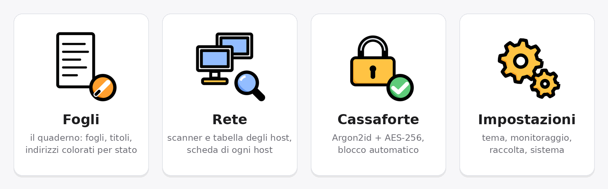
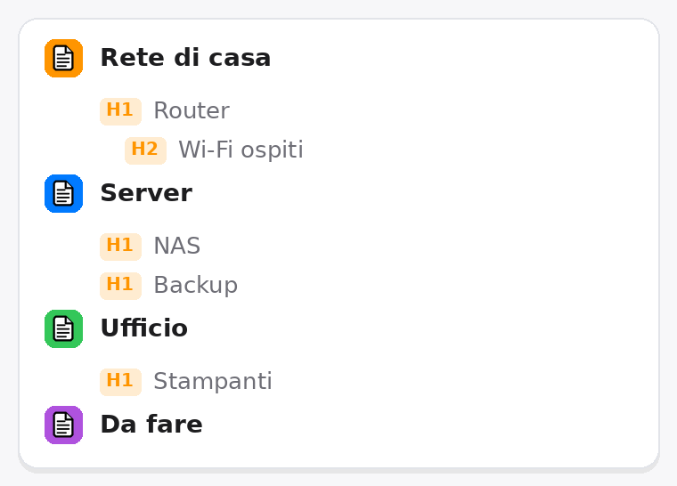
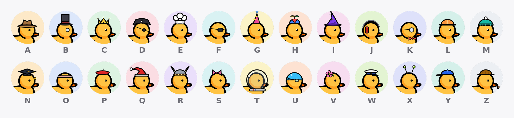

<div align="center">


**Technical notes and a network scanner in the same window.**
Write an address in a sheet and DuckNote checks it; scan a subnet and the
results come back into the note. One executable, nothing to install.

[](https://github.com/Zaick99/DuckNote/releases/latest)
[](https://github.com/Zaick99/DuckNote/releases)


[](LICENSE)

[**Download**](https://github.com/Zaick99/DuckNote/releases/latest) ·
[The window](#the-window) ·
[Writing](#writing) ·
[Network](#network--rete) ·
[Encryption](#encryption) ·
[Building](#building) ·
[Changelog](CHANGELOG.md)

<br>



</div>

> The interface is in Italian. Labels are quoted here exactly as they appear on
> screen, with their meaning in English.

---

## Download

| File | What it is |
|---|---|
| `DuckNote.exe` | portable, about 64 MB — the .NET runtime, WPF and the application in one file. Nothing to install. |
| `DuckNote-<version>-setup.exe` | installer — installs for the current user, no elevation, with shortcuts and an uninstall entry. |

Windows 10 or 11, 64-bit. Neither binary is signed, so SmartScreen warns on the
first run: the SHA-256 of both files is published with every release, and the
running executable shows its own in **Impostazioni › Sistema**.

---

## The window

Since 0.0.12 the interface is rebuilt from scratch on the **Duck** design kit:
macOS-style window with traffic lights, a sidebar, orange accent, day/night
themes that crossfade and can follow Windows, illustrations in the style of the
duck, toasts, and ducks swimming behind the pages.

| Where | What is there |
|---|---|
| top right | the version, the **padlock** (lock now, or set up encryption), the **Impostazioni** gear, day/night |
| sidebar, top | **DuckNote**, then the user: the Windows account's full name, `user on PC`, a picture chosen among 26 dressed-up ducks by the first letter of the name, and a badge with the vault state. A click opens a menu: lock the note or quit — without encryption, it offers to set it up |
| sidebar | **Rete**, with the number of hosts down (red) and up (green) |
| sidebar, middle | **Fogli**: the sheets, each on a tile of its own colour, with their H1/H2 titles always at hand; 🔍 searches them, + adds one |
| sidebar, bottom | the monitoring card, with the button that checks the hosts written in the sheets |
| the rest | the open sheet, full width, or the **Rete** / **Impostazioni** page |

While locked, the whole window is one colour and asks for the password in
place; only the version and day/night stay on top.

<div align="center">



*The sheets in the sidebar: each on a tile of its own colour, with its H1/H2 titles.*



*The user's picture: one duck per initial, A to Z.*

</div>

---

## Writing

**A sheet is a page of paper**: its title is written on it and renames it, and
under the title the words, the page number, the time of the last save, the
zoom and whether the note is encrypted.

**The bar formats, the keyboard too.** The formatting bar is built from one
table in [`NotesPage.Toolbar.cs`](src/DuckNote.App/Pages/NotesPage.Toolbar.cs):
every command is a row with its icon, name, shortcut, group and state, so it is
changed in one place.

- toggles (bold, titles, lists, quote, code...) **stay pressed** where the
  cursor is, and look different from hover;
- what cannot be used is **greyed out**, not hidden;
- every tooltip gives the **name and the shortcut**;
- the bar never wraps: what does not fit goes into the **⋯** menu;
- with nothing selected, a mark applies to the **word under the cursor**, or to
  what you type next;
- **Alt+F10** reaches the bar from the keyboard, the arrows move along it, Esc
  returns to the text.

**Enter starts a clean line** — no title, list, quote, code, bold or colour.
**Shift+Enter** keeps the formatting: the next list item, the next line of the
code block, the same title.

**Markdown-style starts**: `#`, `##`, `###`, `-`, `1.`, `[]`, `>` or ` ``` `
followed by a space at the start of a line turn it into a title, list,
checklist, quote or code block.

**Also in the note**: text colours from the theme, highlight, inline code,
links (http, https, mailto; Ctrl+click opens them), real tables, separators,
code blocks coloured by the language they look like (C#, Python, JavaScript,
Rust, PowerShell, SQL, shell), find and replace, and framed **drawings, images
and charts** the text wraps around. Right-click on a table, a separator, a code
block or a quote deletes it (Ctrl+Z brings it back).

**Addresses live in the text.** IPv4, IPv6 and domain names are collected from
the whole sheet, mid-sentence included, set in monospace and **coloured by
state** — green reachable, red down, grey never checked — a moment after you
stop typing, without the text moving. File names, versions and e-mail
addresses are left alone. Right-click on an address: analyse it now, show its
card, stop analysing it (and put it back later), copy it.

---

## Network — Rete

| Command | What it does |
|---|---|
| `192.168.1.0/24` + **Analizza** | scan a range (CIDR, `from-to`, `.1-254`, comma-separated lists) |
| **Host della nota** | keep in the list only the hosts written in the note, and check them |
| **Tutti · Attivi · Spenti · Da controllare** | show only the hosts in that state |
| **Tutti · Nota · Ricerca** | every host, only those written in the sheets, or only those found by the range search |
| search box | free text, or by field: `ip:` `nome:` `mac:` `porta:` `os:` `tipo:` `produttore:` `gruppo:` `web:` `nota:` `stato:` |
| export / to the note | what is shown, to CSV (opens in Excel as is) or into the sheet as a table |
| **Messi da parte** | hosts set aside, one click (or a right-click on the table) to take them back |

Every row starts with a dot — **green online, orange to check, red offline** —
then the IP and the name. Selecting a row fills the card on the right with
everything the scan collected: names, MAC and vendor, response time, the
operating system it looks like, open ports and services, HTTP/SSH/FTP/SMTP
banners, TLS certificate, SNMP, UPnP, SMB shares, WMI inventory.

**The full analysis runs once per start.** After that, the monitor and every
new check only **ping**: names, MAC, ports and the rest stay as they were found.
A host that comes back on is analysed in full again; restarting DuckNote starts
from scratch. A new range removes only the rows that are not part of it.
Automatic checks never pop up a notification; the ones you start do.

---

## Encryption

Offered at the first start, and any time later from **Impostazioni ›
Cassaforte**, the padlock or the user menu.

- **The password never becomes the key**: Argon2id (256 MiB, 3 passes, 4
  lanes) then PBKDF2-HMAC-SHA512 (600,000 iterations) produce a key that only
  unwraps the random 256-bit key the data is encrypted with — changing the
  password rewrites a hundred bytes, not the note.
- **Content**: AES-256-CBC with HMAC-SHA256, encrypt-then-MAC, fresh IV per
  write, MAC verified before decrypting, padded to 4 KiB steps.
- **Everything in one container**, `store.bin`: note, previous note, last scan,
  hosts set aside, last range. While it exists, nothing is written in the clear.
- **Locking**: the padlock, `Ctrl+L`, or 15 idle minutes (configurable). The
  key leaves memory; while running it sits outside the managed heap, locked out
  of the page file and encrypted with `CryptProtectMemory` when unused.
- **Not covered**: malware or a keylogger in your account, a debugger on an
  unlocked instance, a replaced executable, your screen, and cleartext copies
  made before encryption was turned on.

**If you lose the password, the note is gone.** There is no recovery key.

---

## Shortcuts

| Keys | Action |
|---|---|
| `Ctrl+L` | lock now |
| `Ctrl+F`, `F3`, `Shift+F3`, `Esc` | find in the sheet, next, previous, close |
| `Ctrl+Shift+F` | search the sheets in the sidebar |
| `Ctrl+Alt+0` / `1` / `2` / `3` | normal text, title H1, H2, H3 |
| `Ctrl+B`, `Ctrl+I`, `Ctrl+U`, `Ctrl+Shift+X` | bold, italic, underline, strikethrough |
| `Ctrl+Alt+H`, `Ctrl+E` | highlight, inline code |
| `Ctrl+Shift+8` / `7` / `9` | bullet list, numbered list, checklist |
| `Ctrl+Shift+Q`, `Ctrl+Alt+C`, `Ctrl+Shift+-` | quote, code block, separator |
| `Ctrl+K` | link |
| `Ctrl+Space` | clear formatting |
| `Enter` / `Shift+Enter` | new clean line / new line keeping the formatting |
| `Alt+F10`, arrows, `Esc` | onto the formatting bar, along it, back to the text |
| `Ctrl+Shift+V` | paste as plain text |
| `Ctrl+wheel`, `Ctrl+plus`, `Ctrl+minus`, `Ctrl+0` | zoom the text |

---

## Where the data lives

In `%APPDATA%\DuckNote`, or in the folder named by `DUCKNOTE_HOME` — useful for
keeping everything on a USB stick next to the executable.

| File | Contents |
|---|---|
| `note.xaml` | the note, when encryption is off: a zip with one entry per sheet, their order and names, and the framed drawings, images and charts |
| `note.xaml.bak` | the previous version, refreshed at most every 15 minutes |
| `settings.json` | the settings |
| `lastscan.json` | the last scan, so states are found again on reopening |
| `store.bin`, `store.bin.bak` | with encryption on: everything above except the settings |

Nothing leaves the computer: the only connections are towards the hosts you
scan. Notes, containers and settings written by earlier versions open as they
were.

---

## Building

Requires the .NET 10 SDK.

```powershell
dotnet build DuckNote.sln
dotnet test DuckNote.sln
```

The portable executable:

```powershell
dotnet publish src/DuckNote.App -c Release -r win-x64 --self-contained true `
  -p:PublishSingleFile=true -p:IncludeNativeLibrariesForSelfExtract=true `
  -p:EnableCompressionInSingleFile=true -p:DebugType=none -o dist
```

The installer, with [Inno Setup 6](https://jrsoftware.org/isinfo.php):

```powershell
ISCC.exe packaging\DuckNote.iss /DAppVersion=0.0.12 /DSourceExe=..\dist\DuckNote.exe
```

On Linux the solution builds and the tests run with
`-p:EnableWindowsTargeting=true`; the window itself needs Windows.

---

## Project layout

```
src/DuckNote.Core    cryptography and the encrypted container
src/DuckNote.Scan    the scan engine and the wire protocols
src/DuckNote.Notes   what the note knows without a window: addresses in text,
                     code colouring, charts, the note file, the sheet tree,
                     the host filter and CSV, settings
src/DuckNote.App     the WPF application, on the Duck design kit
  Theme/               design tokens, styles, theme manager
  Ui/                  shared controls: toasts, wizard, segmented, animations
  Pages/               the sheet, Rete, Impostazioni, Cassaforte
  Editor/              the rich-text editor: looks, commands, painters, frames
  Scanning/            the scan session behind the Rete table
  Views/               lock screen, dialogs
tests/               181 tests, including the fixtures written by the
                     original PowerShell version
assets/              logo and icon, the README images, and the scripts that
                     draw the avatars, the sheet icon and the README images
packaging/           the Inno Setup script
```

`DuckNote.Core`, `DuckNote.Scan` and `DuckNote.Notes` do not reference WPF:
they run headless, which is what makes the tests possible.

---

## A note on use

Network scanning belongs **on your own networks, or where you are authorised**:
SNMP probes and share enumeration are intrusive, and on someone else's network
they can be unlawful.

---

## License

MIT — see [LICENSE](LICENSE).
